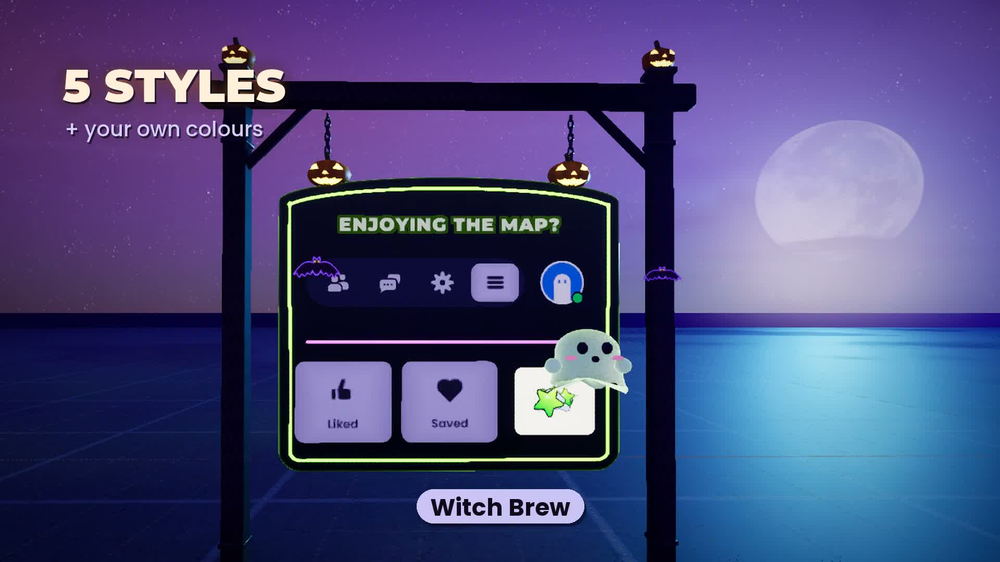

# Boo Board — free animated Halloween "Like · Save · Follow" sign for UEFN

A 3D sign for your island that **shows players where the Like / Save / Follow buttons are**: a little ghost opens the
in-game-style menu (☰), boops **Like**, **Save** and **Follow Dev**, and the board says **"THANKS, BOO!"**.
Pumpkins, bats, chains, candy rain, 5 colour styles, 4 mounts. One Verse device, set up in the Details panel.

Promo videos (YouTube 75 s + Shorts 39 s, with sound effects): `tools/compose2.py` + `promo2/storyboard*.json`
(not in git; they are in the release folder). The first promo (37 s) came from `tools/promo.py` + `tools/compose.py`.

**Why it's light:** every animation runs inside the materials on each player's own machine (World Position Offset +
`Time`). The Verse device only builds the board once when the game starts — no ticking, no server cost, perfectly
smooth at any frame rate, and every board on your island stays in sync (or not, your choice).

## Install (1 minute)
1. Close UEFN. Put the **`BooBoard`** folder from `BooBoard_v<version>.zip` in your project's **`Content`** folder.
2. Open your project. It needs **Scene Graph** enabled (Project Settings → Scene Graph).
3. **Verse → Build Verse Code**.
4. Content Browser → `BooBoard` → **`boo_board_device`** → drag it into the level.
   The board + mount stand **exactly on the device** and face the same way as the device's screen — place the device
   where the sign should stand and aim the screen at your players. The device hides itself when the game starts.
5. Pick a Style and a Mount in the Details panel → Launch Session. Done.

**Why a plain folder copy works:** a `.uasset` stores its references as full package paths
(`/<project mount>/BooBoard/...`) and every UEFN project has its own mount, so assets that reference EACH OTHER break
when copied into another project. The shipped assets therefore reference nothing inside the project:
- materials (`build_materials.py`, default "portable" build): texture-parameter defaults are engine textures UEFN
  allows (`/Engine/Functions/Engine_MaterialFunctions02/ExampleContent/Greyscale` for masks, `.../DebugNumberStrip`
  for colour), no Material Parameter Collection;
- meshes: every default slot is `/Engine/BasicShapes/BasicShapeMaterial`;
- the Verse device creates every material instance and sets every texture at runtime, and reaches the assets through
  qualified names in the relative modules `BB_Meshes`, `BB_Materials`, `BB_Textures` (`BB_Textures.T_BB_Sprites`).
  The asset folders have unique names on purpose (since v1.1.6): with plain `Meshes` / `Materials` / `Textures`, a
  folder of the same name in the buyer's Content root wins `using { Textures }` ("Unknown identifier") and makes
  `Textures.T_BB_...` ambiguous, so the board would not compile (LOG E50, E52).

UEFN validation refuses `/Engine/EngineResources/*` and `/Engine/EngineMaterials/*` (e.g. `DefaultMaterial`,
`WhiteSquareTexture`, `DefaultDiffuse_TC_Masks`): "Disallowed reference … (AssetValidator_AssetReferenceRestrictions)"
and the session will not start. `tools/package.py` refuses to ship an asset that points at another asset of the
project. Verified: the zip's folder, copied unmodified to another path, loads all 32 assets with zero project
dependencies, and a play session renders every board correctly.

## Details panel
| Group | Setting | What it does |
|---|---|---|
| 1 Board | **Style** | Pumpkin Night · Ghostly Mint · Witch Brew · Blood Moon · Candy Pop |
| | **Headline** | ENJOYING THE MAP? · HAVING FUN? · HAPPY HALLOWEEN! · SUPPORT THIS MAP · SPOOKY GOOD TIME? |
| | **Thanks Message** | THANKS, BOO! · THANK YOU! · YOU ROCK! · SPOOKTACULAR! · STAY SPOOKY! |
| | **Board Scale** | 0.4 – 3 (1 ≈ a 5.5 m arch) |
| | **Animation Speed** | 0.4 – 2.5 (1 = one show every 11 s) |
| | **Sync All Boards** | on: every board plays together · off: each starts at a random moment |
| | **Play When Player Near** | off (default): the show loops forever · on: the board waits closed until a player comes close, then plays from the start and repeats while someone is near; when everyone has left it finishes the current show and stays closed |
| | **Trigger Distance** | how close a player must be for Play When Player Near (3 – 60 m, default 10 m) |
| 2 Mount | **Mount** | Graveyard Arch · Lantern Post · Spider Thread · Floating Magic · No Mount (just the board, its open bottom edge 20 cm above the device — e.g. against a wall) |
| | **Hang Length** | chain length for the arch / post (20 – 140 cm) |
| | **Sway Amount** | how much a hanging board swings (0 = still) |
| | **Float Height** | height of the board for Floating Magic / Spider Thread |
| | **Distance From Device** | 0 (default) = exactly on the device; higher = that many cm in front of the device's screen |
| 3 Show / Hide | Ghost · Bats · Pumpkins · Candy Rain · Bursts | switch parts off |
| 4 Custom Colors | **Use Custom Colors** + Board, Trim, Text, Like, Save, Follow, Ghost Glow, Mount | your own palette |

The menu bar and the tiles deliberately use in-game-menu colours (dark navy, lavender highlight) in every style, so
players recognise them; the styles theme the frame, texts, ghost, pumpkins and mount.

## How "Play When Player Near" works
The show runs on every player's own clock, so the server can't simply say "start now". Instead the device slides the
board entity forward 2 cm per second with a `keyframed_movement_component` (client-interpolated, smooth) and the
materials read that slide as their clock — and cancel it in the World Position Offset, so the board stands still.
Shows alternate forward/backward so the board never has to jump back.

## Notes
- Players **can't click** the board; it is a looping guide. Liking/saving/following happens in the real Fortnite menu.
- There is no Verse API for a player's avatar picture (UEFN 42.30), so the avatar chip is a little ghost for everyone.
- The board has no collision; the posts of the arch / lantern post have invisible colliders.
- Everything (meshes, textures, icons) is generated from code in [`tools/`](tools) — no Epic assets, fonts are SIL OFL
  (Montserrat, Poppins). Free to use in your islands.

## How it's built (for the repo)
| File | What |
|---|---|
| `tools/board.py` | layout (cm) + the 11 s timeline + ghost keyframes — single source of truth |
| `tools/build_meshes.py`, `tools/meshes.py` | bevelled extrusions, lathes, tubes → OBJ with one material slot per part |
| `tools/art.py`, `tools/art_ui.py` | SDF-drawn textures (mask channels recoloured in the materials) |
| `tools/matgraph.py` | material graphs as Python expressions, built in one `execute_tool_script` call |
| `tools/build_materials.py` | the 8 master materials (Panel, Card, Button, Ghost, Burst, Bats, Pumpkin, Mount); portable by default, `--promo-clock` adds the MPC |
| `tools/build_instances.py` | material instances as mesh defaults (editor previews only; NOT portable) |
| `tools/portable_meshes.py` | every mesh slot → `BasicShapeMaterial` again (run before packaging) |
| `tools/package.py` | release zip = drop-in `BooBoard/` folder + READ ME; refuses assets that reference the project |
| `tools/gen_verse.py` | writes `verse/boo_board_layout.verse` from `board.py` |
| `verse/boo_board_device.verse` | the device: Details panel, palettes, spawning, per-part material instances |
| `tools/frames.py`, `tools/promo.py`, `tools/compose.py` | first promo: frame-exact renders (FreezeTime) + titles → MP4 |
| `tools/mirror.py`, `tools/editor_hide.py` | editor copies of the runtime boards (per-board mesh copies in `/BooPromo`) for renders |
| `tools/render_shots.py`, `tools/clock.py`, `promo2/shots*.json` | frame-exact shots with one MPC write per frame; `roll: 90` = portrait |
| `tools/compose2.py`, `tools/bats.py`, `tools/sfx.py`, `tools/thumb.py` | storyboard → MP4 (landscape + Shorts), brand transition with bats, synthesized SFX, Shorts thumbnail |
| `verse/euphoriax_header.txt` | Euphoriax header on every Verse file (`gen_verse.py` adds it to the layout file) |
| `verse/test/` | test-only device that moves the player in front of the board (not part of the release) |

Rebuild everything: `art.py` → `build_meshes.py` → `import_assets.py all` → `build_materials.py` → `portable_meshes.py`
→ `gen_verse.py` → push the `verse/*.verse` files → Build Verse → start a session (validation) → `package.py`.
Lessons: `experiments/LOG.md` E24–E37, E52.
